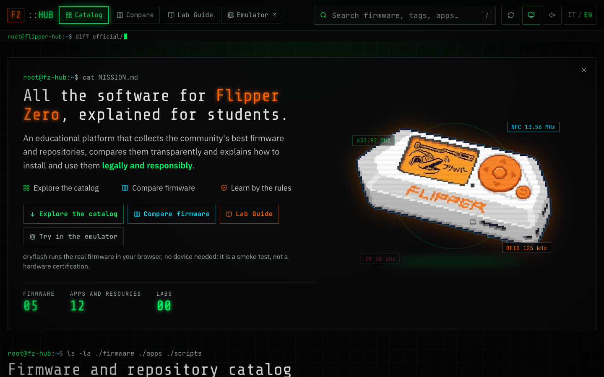
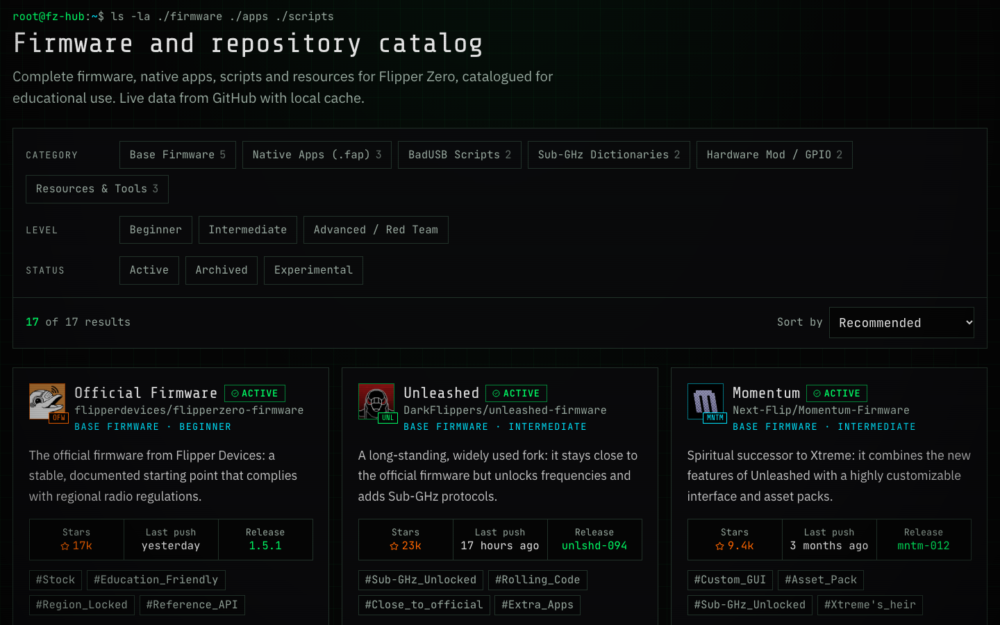
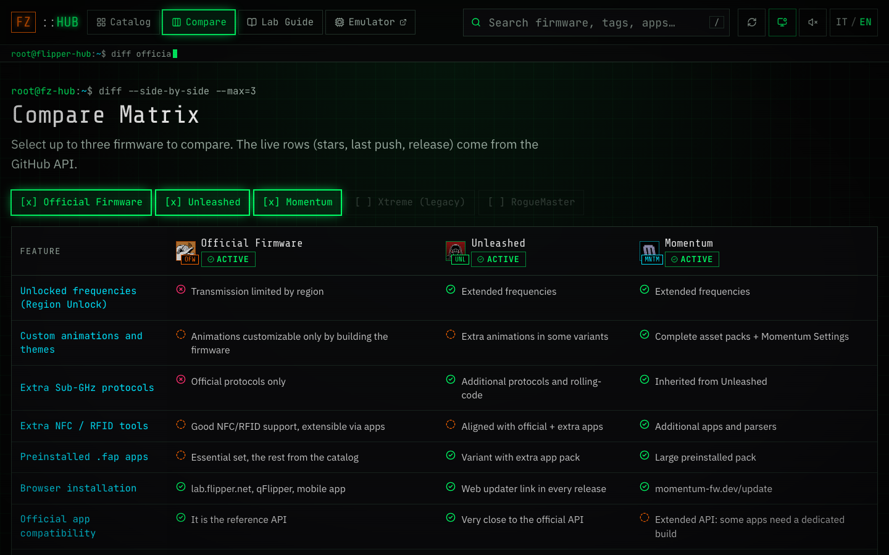
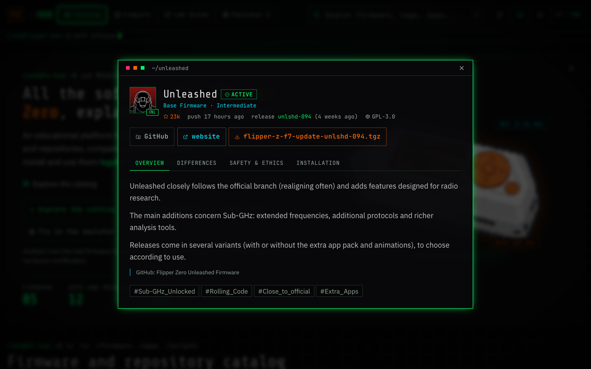

<h1 align="center">Flipper Zero Firmware Hub</h1>

<p align="center">
  <b>An educational, terminal-style catalogue that compares Flipper Zero firmware and community repositories and explains how to use them legally and responsibly.</b>
</p>

<p align="center">
  <a href="https://esposito-vincenzo.it/flipper-zero-firmware-hub/"><b>🌐 Live demo</b></a> ·
  <a href="https://github.com/vincenzo-esposit0/dryflash-FZ"><b>🧪 dryflash emulator</b></a> ·
  <a href="#run-it-locally"><b>⚙️ Run locally</b></a>
</p>

<p align="center">
  
</p>

---

## At a glance

| | |
|---|---|
| **What it is** | A static web platform that catalogues 17 firmware builds, apps, scripts and resources for Flipper Zero, with live GitHub data |
| **Who it is for** | Students and newcomers who want to understand the ecosystem before installing anything |
| **My role** | Sole author: concept, research and curation, UX and visual design, front-end development, CI/CD |
| **Stack** | React 18 · TypeScript · Vite 5 · Tailwind CSS 3 · GitHub Actions · GitHub Pages |
| **Highlights** | Side-by-side comparison matrix · Italian and English · live data with a three-level cache · no backend, no tracking |
| **Companion project** | [dryflash](https://github.com/vincenzo-esposit0/dryflash-FZ), my in-browser emulator for trying firmware before flashing it |

## Why I built it

The Flipper Zero community produces a lot of firmware forks and tools, but the information is scattered across READMEs, Discord servers and forums. A beginner cannot easily tell an official, region-compliant build from an experimental one, and rarely finds the legal context in the same place. The hub gathers everything in one catalogue, compares it transparently, and puts **responsible use first**: every entry carries notes on radio regulations and on the law around computer misuse.

## Features

### Curated catalogue
17 entries in 6 categories (base firmware, native `.fap` apps, BadUSB scripts, Sub-GHz dictionaries, GPIO mods, resources), with filters by category, level and status, sorting, and search on the <kbd>/</kbd> key.



### Comparison matrix
Up to three firmware builds side by side, by feature: region unlock, Sub-GHz protocols, NFC/RFID tools, preinstalled apps, installation method and API compatibility.



### Detail sheets
Each entry has an overview, the differences from the official firmware, a *Safety & ethics* tab and installation steps, plus the latest release to download straight from GitHub.



It also has:
- live stars, last push and latest release for every repository;
- an optional CRT effect and interface sounds;
- shareable deep links (`#/compare`, `#/repo/<id>`);
- a Lab Guide framework for hands-on exercises, still being written.

## Engineering decisions

- **Static by design.** There is no server to secure or pay for. The site is a `dist/` folder that can be hosted anywhere.
- **Resilient GitHub data.** The public API allows only 60 requests per hour per visitor, so the client tries three sources in order:
  1. a `localStorage` cache that is valid for 6 hours;
  2. a snapshot (`github-cache.json`) that GitHub Actions builds with `GITHUB_TOKEN` on every push and once a day;
  3. the live API.

  The token is used only at build time and never reaches the browser bundle.
- **Data separate from the UI.** Entries, the feature matrix and the translations are typed TypeScript data (`src/data/`). Adding a repository means adding one object, and the prefetch script picks it up automatically.
- **Hash routing.** With `#/…` routes, GitHub Pages needs no 404 fallback.
- **Accessible and fast.** It has a skip link, keyboard shortcuts and labelled controls. There is no tracking or analytics.

## Run it locally

```bash
npm install
npm run dev          # http://localhost:5173
npm run build:full   # prefetch GitHub data, then build into dist/
```

### Deploy

- **GitHub Pages:** in **Settings → Pages**, set **Source** to **GitHub Actions** and push to `main`. The workflow sets `BASE_PATH=/<repo-name>/` automatically; use `/` for a custom domain.
- **Other hosts:** `npm run build:full` produces a static `dist/` folder.

| Host | Build command | Output | Variables |
|---|---|---|---|
| Cloudflare Pages | `npm run build:full` | `dist` | `GITHUB_TOKEN` (optional), `BASE_PATH=/` |
| Vercel | `npm run build:full` | `dist` | `GITHUB_TOKEN` (optional) |
| GitLab Pages | `npm run build:full && mv dist public` | `public` | `BASE_PATH=/<project>/` |

### Project structure

```
.github/workflows/deploy.yml   build and deploy (on push to main and daily)
scripts/prefetch-github.mjs    builds public/github-cache.json at build time
src/
  data/       entries, feature matrix, labs, UI strings, English translations
  lib/        GitHub client and cache, i18n, settings, sound
  hooks/      hash router
  components/ header, filters, cards, detail and installation modals,
              comparison table, lab guide
```

### Adding content

- **New repository:** add an `Entry` to `src/data/firmwares.ts`, plus its English text in `src/data/firmwares.en.ts`.
- **New lab:** follow the commented schema in `src/data/labs.ts`.
- **Interface text:** edit `src/data/strings.ts`.

## Responsible use

This project is educational. Use a Flipper Zero only on devices and systems you own or have written permission to test, and respect your country's radio regulations. The hub links to third-party projects and is not affiliated with Flipper Devices Inc.

## License

MIT. See [LICENSE](LICENSE).

---

<sub>Vincenzo Esposito · <a href="https://esposito-vincenzo.it/">Website</a> · <a href="https://www.linkedin.com/in/vincenzo-e">LinkedIn</a></sub>
